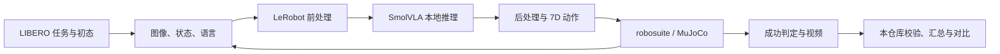

# VLA-Inference-Engine

面向视觉—语言—动作模型（VLA）的测评与推理工程项目。以可独立运行、验证和展示的子项目逐步构建 VLA + Infra 工作流。

**当前已完成：SmolVLA 在 LIBERO 上的双模型测评与结果审计。** 在固定环境和协议下，对公开 checkpoint 与本地训练的 100k checkpoint 完成了 **2400 个 episode**，保存逐 episode 视频和原始结果，并通过六个 seed 及两套汇总的正式校验。

[实验报告](docs/experiments/smolvla_libero_20261105/REPORT.zh-CN.md) · [项目思考与代码阅读路线](docs/PROJECT_GUIDE.zh-CN.md) · [测评运行手册](docs/runbooks/libero.md) · [交互演示台运行手册](docs/runbooks/live-viewer.zh-CN.md) · [后续路线](docs/ROADMAP.md)

## 四个可独立交付的子项目

本仓库作为大项目共享一套 Python 包、配置、测评协议和基础设施。每个子项目有独立的目标、入口与验收说明，避免复制模型、环境和控制循环代码。

| 子项目 | 交付内容 | 状态 |
|---|---|---|
| [01 · SmolVLA + LIBERO 测评](docs/projects/01-smolvla-libero/README.md) | 双模型正式测评、结果审计、实时交互演示 | 本机阶段完成 |
| [02 · 部署性能测评](docs/projects/02-deployment-benchmark/README.md) | 延迟、吞吐、显存与成功率的联合报告 | 规划中 |
| [03 · 异步与远程推理](docs/projects/03-async-remote-inference/README.md) | 动作队列、RTC、远程执行与故障实验 | Mock 原型，真实链路待实现 |
| [04 · 推理加速](docs/projects/04-inference-acceleration/README.md) | 推理优化及成功率、延迟、资源对照 | 规划中 |

完整的项目边界、依赖关系和 GitHub 组织决定见[项目主文档](docs/PROJECT_GUIDE.zh-CN.md)。

## 项目做了什么

本仓库负责测评的组织、协议约束和结果审计；SmolVLA 模型加载、前后处理与 rollout 复用固定版本的 LeRobot，任务、Panda 机械臂和仿真环境由 LIBERO / robosuite / MuJoCo 提供。

- **统一入口**：提供资产预检、单任务 smoke、完整测评和双模型对照命令。
- **固定实验条件**：记录模型与数据 revision、LeRobot commit、checkpoint 哈希、实际命令和运行环境。
- **真实仿真闭环**：由任务语言和双相机观测驱动本地模型推理，将动作送入模拟器并判断任务成功。
- **完整结果证据**：检查任务矩阵、episode 数量、视频、原始结果与汇总的一致性。
- **可恢复的长任务**：GPU / 存储门禁、seed 级续跑、保留失败运行产物。
- **统计与诊断**：生成任务和套件成功率、置信区间、双模型配对分析及失败视频索引。



## 实测结果

实验于 **2026-11-05** 完成。每模型使用 3 个评测 seed，每套件累计 300 个 episode；总体成功率按 1200 个 episode 计算。下表全部为本项目的本机实测值。

| LIBERO 套件 | 公开 checkpoint | 本地 100k checkpoint | 本地减公开 |
|---|---:|---:|---:|
| Spatial | 75.33% | 77.67% | +2.33 个百分点 |
| Object | 88.33% | 86.00% | −2.33 个百分点 |
| Goal | 79.00% | 81.33% | +2.33 个百分点 |
| Long | 37.67% | 58.00% | +20.33 个百分点 |
| **总体** | **70.08%（841/1200）** | **75.75%（909/1200）** | **+5.67 个百分点** |

本地模型的主要优势来自 Long。配对分析中，Long 的 seed×task 聚类 bootstrap 差值 95% 区间为 `[+11.00, +29.00]` 个百分点；另外三个套件的差值区间均跨零。完整统计和证据来源见 [实验报告](docs/experiments/smolvla_libero_20261105/REPORT.zh-CN.md) 与 [实验记录 JSON](docs/experiments/smolvla_libero_20261105/experiment_record.json)。

### 模型来源与比较范围

| 项目 | 公开 checkpoint | 本地 100k checkpoint |
|---|---|---|
| 来源 | `HuggingFaceVLA/smolvla_libero` | 本地 LIBERO 训练产物 |
| 项目标签 | `smolvla_libero_paper` | `smolvla_libero_100k` |
| VLM | `SmolVLM2-500M-Instruct` | `SmolVLM2-500M-Video-Instruct` |
| VLM 文本层 / 动作专家层 | 32 / 32 | 16 / 16 |
| 动作专家宽度倍率 | 0.5 | 0.75 |

公开模型固定 revision 为 `6721902bc4d61e50a3bfdb11dfb4cb626f05d102`。代码中的 `paper` 标签沿用项目命名；现有模型卡不足以证明该 checkpoint 与论文表格使用的是完全相同的实验产物。

本地模型从预训练 VLM 加新建动作专家开始训练，**没有从上述公开 LIBERO checkpoint 继续微调**。两者初始化和模型结构不同，本实验衡量的是两个具体 checkpoint 在同一评测协议下的表现。结果尚不能归因于某个单独的训练或架构改动。

### 本地训练记录

| 参数 | 本次实际值 |
|---|---|
| 数据集 | `lerobot/libero`；40 任务，1693 episodes，273465 frames |
| 优化器更新 / 训练 seed | 100000 / 1000 |
| 物理 batch / 梯度累积 | 64 / 1 |
| 优化器 | AdamW；betas=(0.9, 0.95)，weight decay=1e-10，grad clip=10 |
| 学习率 | 1e-4；warmup 1000 步；cosine decay 至 2.5e-6 |
| 训练范围 | 冻结 VLM，训练动作专家、state/action 投影和时间 MLP |
| 精度 / 编译 | bf16 / policy `max-autotune` |
| 硬件 / 训练循环耗时 | 单张 RTX 3090 / 约 21.51 小时 |

完整配置已保存为 [train_config.json](docs/experiments/smolvla_libero_20261105/train_config.json)。训练脚本位于原训练项目；本仓库提供 checkpoint 接入和测评入口，记录该次训练以解释受测模型的来源。

## 测评协议

协议定义集中在 [benchmark/protocol.py](src/vla_inference_engine/benchmark/protocol.py)，命令生成和校验共用明确的实验约束。

| 项目 | 固定设置 |
|---|---|
| 环境 | LIBERO Panda；robosuite / MuJoCo |
| 套件 | Spatial、Object、Goal、Long，各 10 个任务 |
| 观测 | 双路 256×256 RGB、8D state、任务语言 |
| 动作 | 7D relative：末端平移 3 + 旋转 3 + 夹爪 1 |
| 推理 | chunk size=50，flow steps=10，每次执行 1 个动作后重新观测 |
| 仿真执行 | 固定初态、hard reset、单环境同步 rollout |
| 最大步数 | Spatial 280 / Object 280 / Goal 300 / Long 520 |
| 评测 seed | 1000、2000、3000 |
| 正式规模 | 4 套件 × 10 任务 × 10 episodes × 3 seeds = 1200 episodes/模型 |
| 测评编译 | `compile_model=false` |

训练数据用于数据与 processor 契约检查；评测中的图像、状态和任务反馈由模拟器在线产生。smoke 只验证链路，其结果不会并入正式成功率。

## 快速开始

以下命令均在仓库根目录执行。先使用公开 checkpoint 完成单任务 smoke，再启动完整测评。

### 1. 准备环境和资产

已验证的环境为 Linux、Python 3.12.13、RTX 3090 24 GiB、PyTorch 2.11.0+cu128、LeRobot 0.6.2、hf-libero 0.1.4、MuJoCo 3.8.1。LeRobot 固定 commit：`8ae2354592ec4480c38134fb75350b8e7992e0e9`。

准备 Conda 或 Mamba、Git 和可用的 NVIDIA 驱动，然后执行：

```bash
bash scripts/bootstrap_env.sh
conda activate libero
bash scripts/download_assets.sh
```

安装脚本使用 [环境文件](environment.yml) 和 [Linux/cu128 依赖锁](requirements-linux-cu128.lock.txt)，下载脚本获取固定版本的公开权重、base 权重、数据、LIBERO 场景资产和 tokenizer。base 权重属于当前预检资产集合，不代表本地 100k 模型以它初始化。

安装与下载入口已实现；**从空目录开始在另一台机器上完整重建的流程尚未验证**。当前完成的是本机固定环境下的端到端测评。

若已有完整外部资产集合，可在下载前改用链接方式。`--source-root` 需包含脚本定义的 `artifacts/`、`vendor/`、`.cache/` 布局，见 [资产链接工具](tools/link_assets.py)；下载和链接是两种资产准备方式，请按已有目录状态选择。

```bash
conda activate libero
python tools/link_assets.py --source-root /path/to/assets-root
python -m pip install -e . --no-deps
```

权重、数据、视频及缓存均保存在 Git 外部。当前仓库没有附带本地 100k 权重或其公共下载地址；复现双模型结果需要另行提供该 checkpoint。

### 2. 预检和单任务 smoke

```bash
vla-engine eval-preflight --model artifacts/models/smolvla_libero_paper

vla-engine eval-smoke \
  --model artifacts/models/smolvla_libero_paper \
  --suite libero_spatial --task-id 0 --episodes 1 --seed 1000 \
  --out runs/smoke-paper-spatial0-seed1000
```

预检不执行 GPU rollout，结果写入 `outputs/preflight/` 和 `outputs/provenance/`。smoke 会执行真实仿真，在指定目录保存命令、日志、视频、原始指标和 `smoke_validation.json`；每次 smoke 使用新的输出目录。

### 3. 完整测评

运行公开 checkpoint 的 1200 个 episode：

```bash
GPU_CHECK_INTERVAL_SECONDS=60 vla-engine eval-formal \
  --model artifacts/models/smolvla_libero_paper \
  --label smolvla_libero_paper
```

若已持有本地 100k checkpoint，可绑定包含模型配置、权重及前后处理器的 `pretrained_model` 目录，然后执行双模型测评、配对比较与诊断准备：

```bash
python tools/link_assets.py \
  --local-model /path/to/checkpoints/100000/pretrained_model

GPU_CHECK_INTERVAL_SECONDS=60 bash scripts/eval_two_models.sh
```

正式 runner 每个 seed 开始前默认要求至少 **20 GiB 空闲空间**，并等待 GPU 门禁通过；20 GiB 是启动检查阈值，资产下载与视频总量仍需另外预留空间。本次 RTX 3090 上，两模型累计 rollout-core 耗时约 **43 小时**，不含全部预检和汇总开销，其他硬件或 checkpoint 的耗时可能不同。

**续跑以完整 seed 为单位。** 再次执行同一命令时，校验通过且匹配当前模型的完整 seed 可以跳过；未完成的 seed 会保留旧产物后重新运行，不支持从中断 episode 内部接着执行。

## 交互式 LIBERO 演示台

独立于正式测评的本地页面支持选择四个 suite 中的任意 task、公开或本地 checkpoint、seed 和固定初态。加载后可以实时查看主相机与腕部相机、任务原文、策略和环境动作及 XYZ 历史曲线，并执行模型接管、暂停、继续、单步、重置和结束。交互结果保存到 `runs/live/`，包含逐步 trace、双相机 JPEG/MP4 和 checkpoint 哈希，不计入上文的成功率。

```bash
conda activate libero
python -m pip install -e '.[live]'
vla-engine live --host 127.0.0.1 --port 8765
```

浏览器访问 `http://127.0.0.1:8765/`。需要固定资产和至少一个完整 checkpoint；只有一个活动会话。运行方式、记录字段与代码阅读路线见 [交互演示台运行手册](docs/runbooks/live-viewer.zh-CN.md)。

## 结果与验收

```text
outputs/
  preflight/                  资产、processor、命令与协议预检
  provenance/                 模型/数据来源、环境和版本记录
  logs/eval/<label>/          每个 seed 的运行日志
results/
  raw/<label>/seed_<seed>/    eval_info.json、视频、命令和 seed 校验
  <label>/                   套件/任务统计与 formal_validation.json
  comparison/                双模型对照与配对统计
  diagnostics/               失败视频索引与差距诊断计划
  failed_runs/               未完成或校验未通过的旧运行
```

正式 runner 从 raw 重算汇总并执行验证；引用正式成功率前，应确认对应 `formal_validation.json` 的 `valid=true`。原始运行产物由 `.gitignore` 排除，仓库保留的小型归档位于 [docs/experiments/smolvla_libero_20261105/](docs/experiments/smolvla_libero_20261105/)。这些归档包含统计、配置和哈希引用，完整视频与原始数据由实验执行者另行保存。

## 目录与阅读路线

```text
src/vla_inference_engine/
  benchmark/       测评协议、命令构造、运行环境与 smoke 校验
  live/            实时演示台的任务目录、工作进程、会话、服务与网页
  contracts/       观测、动作与控制接口
  control/         控制循环、时钟、动作队列原型
  inference/       同步推理接口
  adapters/        Mock 环境与策略
  telemetry/       执行轨迹记录
  cli.py           vla-engine 命令入口
scripts/           环境安装、资产下载、资源门禁和正式测评编排
tools/             资产、processor、协议、视频、汇总与诊断工具
configs/evaluation/  公开基线和来源记录
tests/             核心逻辑、契约、集成及固定资产测试
docs/              架构、运行手册、实验记录和中文项目思考
```

建议依次阅读：`benchmark/protocol.py` → `benchmark/libero.py` → `cli.py` / `benchmark/smoke.py` → `scripts/eval_all_suites.sh` → `tools/validate_formal_seed.py` → `tools/summarize_results.py` / `compare_models.py`。模型与模拟器之间的核心 rollout 在固定 LeRobot 源码中；完整跨仓库阅读路线见 [项目思考文档](docs/PROJECT_GUIDE.zh-CN.md)。

## 开发验证

Python 3.12 环境下，无 GPU、无模型资产的核心验证与 CI 命令：

```bash
python -m pip install -e '.[test]'
python -m pytest -q tests/unit tests/contract tests/integration
python -m ruff check src
```

准备好固定 LeRobot、模型和数据后，可执行完整测试集：

```bash
python -m pytest -q tests
python -m ruff check src tools tests
```

2026-11-05 本机完整测试集通过 47 项，Ruff 检查通过；交互演示台另以两套真实 checkpoint、四个 suite 和浏览器操作验收。CI 执行无资产核心测试；正式 GPU 测评通过上述运行入口单独开展。

后续控制循环开发可先使用 CPU Mock 演示：

```bash
vla-engine mock --ticks 100 --seed 0 --out runs/mock-demo
```

该演示用于接口、动作队列和轨迹验证，当前正式 SmolVLA 测评走 LeRobot rollout 链路。

## 当前边界与后续计划

首个测评子项目已完成本机验收。公开 checkpoint 的 Long 结果与项目记录的论文参考分数存在差距，已触发诊断计划，根因审查和独立 seed 4000 复测尚未完成；因此当前结果不代表已严格复现论文分数。新机器重建验证也仍待完成。

接下来在已有成功率基准上逐步开展：

- 部署测评：端到端延迟、吞吐、显存和成功率的联合报告。
- 推理执行：真实策略接入自有控制循环、动作队列、异步与远程推理。
- 加速实验：编译与执行策略优化，以及性能变化对任务成功率的影响。

上述方向属于后续子项目，目前仓库中的相关控制组件处于原型阶段。详细状态见 [路线图](docs/ROADMAP.md)。

## 依赖与许可

本项目复用 SmolVLA、LeRobot、LIBERO、robosuite 和 MuJoCo 的模型与仿真实现。固定版本与下载来源见 [scripts/common.sh](scripts/common.sh)，论文参考指标来源见 [configs/evaluation/baselines.json](configs/evaluation/baselines.json)。

本仓库代码采用 [MIT License](LICENSE)。第三方源码、模型、数据和场景资产遵循各自的许可。
