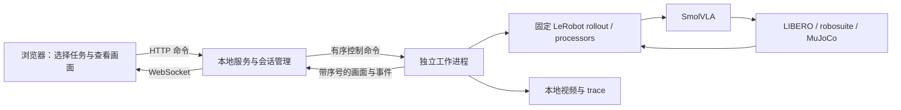

# LIBERO 交互式模型演示台：实现规划

日期：2026-11-05。状态：核心交互链路已实现并完成代表任务验证；本文保留原设计与后续扩展清单。正式测评代码和既有结果未改动。

## 1. 目标与第一版体验

用户在本机浏览器选择 suite、task、checkpoint、随机 seed 和固定初态编号，点击“加载场景与模型”，看到场景预览及原始英文任务指令；点击“模型接管”后，模型执行任务，页面持续展示双相机画面、动作数值、仿真进度和运行状态。支持暂停、继续、执行一步、重置同一初态、结束会话和保存记录。

第一版限定四个现有正式 suite、单任务、单环境、单个活动模型，使用当前固定 LIBERO 和 LeRobot 版本。模型选择预置公开 checkpoint 与本地 100k checkpoint；外部模型后续通过本地配置注册。模型切换应结束当前运行并清理旧进程，避免同时驻留两套模型。

页面布局：

```text
┌ 任务配置 ──────────┬ 相机画面 ──────────────────┬ 实时状态 ───────────┐
│ suite / task      │ 主相机：桌面、物体、机械臂  │ step / horizon     │
│ 模型 / seed       │ 腕部相机：夹爪附近视角      │ 推理 / 仿真耗时    │
│ 初态编号          │                            │ success / 结束原因 │
├──────────────────┴────────────────────────────┴────────────────────┤
│ 任务原文：直接来自 LIBERO task.language                              │
│ [加载] [模型接管] [暂停/继续] [执行一步] [重置] [结束]                 │
├────────────────────────────────────────────────────────────────────┤
│ 7D 模型输出 / 最终环境动作 / 历史曲线 / 事件日志                       │
└────────────────────────────────────────────────────────────────────┘
```

“模型接管”在第一版指从暂停的初态进入模型自主控制，不包含人工遥操作交接。“实时”指每个真实仿真步产生后尽快显示；运行速度由推理、渲染、传输和仿真耗时决定。页面分别显示墙钟时间、仿真时间、实际 step/s 和画面更新时间，不预先承诺 20 Hz 控制或 30 FPS 显示。暂停时不继续推进物理仿真。

## 2. 已核实的复用基础

| 现有部分 | 复用方式 | 需要补足 |
|---|---|---|
| `benchmark/protocol.py` | suite、horizon、输入输出和推理设置 | 交互运行配置，标记 `formal_result=false` |
| `benchmark/libero.py` / `runtime.py` | 模型元信息检查、固定环境与资产路径 | 不把后台长任务放在网页请求中阻塞执行 |
| LeRobot `envs/libero.py` | 任务说明、固定初态、Panda 环境、成功判定、相机观测 | 双视图发布、初态选择和生命周期管理 |
| LeRobot `scripts/lerobot_eval.py` | `make_env`、`make_policy`、processor 工厂及 `rollout` | 渲染回调、动作观测和交互控制桥接 |
| LeRobot `rollout(render_callback=...)` | reset 后及每一步 `env.step` 后触发，适合预览与暂停 | 独立工作进程内处理命令；终止请求需保证 finally 清理 |
| 原项目 `dashboard/app.py` / `backend.py` | 可参考任务元信息、模型说明与结果索引 | 现实现用阻塞 subprocess 运行后 `st.video` 播放，不能直接提供逐步直播 |
| `telemetry/trace.py` | 参考逐步记录和单调时钟 | 定义直播事件字段，避免强行沿用 Mock 的 2D 动作语义 |

保持固定 vendor 源码完整。优先为官方 rollout 的回调和 processor 增加本仓库侧观察包装，复用其推理/控制顺序。第一步技术验证若发现回调无法覆盖所需状态或终止语义，再记录具体限制并考虑最小逐步 runner；不预先复制整份评测实现。

## 3. 推荐架构

采用本机浏览器页面 + Web 服务 + 一个独立仿真/推理工作进程。前端使用原生 HTML/CSS/JavaScript，减少构建环节。服务负责控制接口和 WebSocket 推送，独立进程拥有模型、CUDA、MuJoCo/EGL 上下文和 episode 状态。当前固定环境已有 Starlette 和 Uvicorn，实际实现使用它们提供上述能力。



这是为后续部署与远程推理保留服务边界的选择。实际实现使用 `subprocess.Popen` 启动全新 Python 解释器，在工作进程内部初始化 CUDA 与 EGL；跨进程仅发送 CPU 数值与压缩图片，不传递 CUDA 张量。新 Web 依赖放在独立可选依赖组，固定训练/测评核心栈没有升级。

第一版绑定 `127.0.0.1`，一个活动会话；浏览器刷新通过 session ID 恢复状态，避免重复创建 GPU 进程。连接长期中断时在步边界暂停，停止/退出应关闭环境并回收工作进程。后续如需要局域网访问，再明确部署与访问控制方案。

参考：[FastAPI WebSockets](https://fastapi.tiangolo.com/advanced/websockets/)、[PyTorch multiprocessing](https://docs.pytorch.org/docs/stable/notes/multiprocessing.html)。实现以项目安装的固定 PyTorch 版本为准。

## 4. 推理与状态控制

### 4.1 保持模型实际输入输出一致

工作进程沿用官方顺序：

```text
环境观测 → preprocess_observation → task.language
→ env_preprocessor → checkpoint preprocessor
→ policy.select_action
→ checkpoint postprocessor → env_postprocessor
→ env.step → render_callback → 下一步
```

前后处理观察包装只记录数值和时间，不修改张量、随机数状态或动作。模型输出、反归一化动作、最终送入 `env.step` 的动作分层展示。7D 动作的标签为相对平移、旋转、夹爪；控制器仍可能进行缩放，因此环境动作值不能直接标为实际米/弧度位移。实际机械臂反馈来自观测 state，并按当前 LIBERO 格式明确字段含义。

SmolVLA 在此路径中输出动作，不输出可供展示的自然语言解释或标准“置信度”。第一版显示实际执行的动作。完整 50×7 预测块作为扩展：当前 `select_action` 只返回一个动作，需要验证对同一次 `_get_action_chunk` 的只读观测方式，不能为画图额外推理一次，也不能把预测动作块直接称作确定的末端轨迹。

### 4.2 任务与初态

suite/task 列表从当前 LIBERO 元信息读取，显示 task ID 和原始语言描述。四个 suite 的范围复用本项目协议；task 选择不需要新建 XML。初态编号与随机 seed 分开显示：当前 `LiberoEnv.reset` 会推进初态计数，仅重复同一个 seed 并不能保证回到同一固定初态。

加载时完成资源检查、模型初始化与正式 reset，在官方 rollout 的首次渲染回调停住，提供 READY 状态预览。点击接管后从该状态继续，避免“预览一次 reset、正式运行又 reset 一次”跳过用户选定初态。重置同一场景时显式恢复初态选择、重新设定随机种子并调用 `policy.reset()`，清空残留动作队列。reset 与终止处理需要覆盖 vector env 的 `NEW_ROLLOUT_OPTION`、自动 reset 和 terminal observation 语义。

### 4.3 会话状态机

```text
IDLE → LOADING → READY → RUNNING ⇄ PAUSED
                              → FINISHED
任意活动状态 → STOPPING → CLOSED
发生异常 → ERROR
```

READY/PAUSED 下，“执行一步”只放行一次策略动作和一次 `env.step`，随后返回 PAUSED。暂停在当前推理和仿真步结束后确认，界面先显示“正在暂停”，收到确认后才显示“已暂停”。不承诺在 CUDA kernel 执行中瞬时暂停。成功、超时和用户结束使用不同结束原因；完成后保留最终画面，用户选择重置后再开新 episode。

通过 `session_id / generation_id / command_id / step_id` 标识命令、事件和画面。任务切换或重置后拒绝旧 generation 事件；重复点击不触发重复步进；仅允许一个控制执行序列。

## 5. 图像、数值与记录

- 同时展示主相机和腕部相机。第一版取自已有 256×256 观测，可在浏览器放大；图像方向应与 LIBERO 环境 processor 的 180° 旋转约定一致，并区分“场景显示图”和经过模型 resize/归一化的输入。自定义观察相机后续增加。
- 快照带观测步号、动作步号、前/后状态标记和单调时钟时间戳，明确 `obs_t → action_t → obs_{t+1}`。推送双相机与动作时不能将不同步的数据拼成同一瞬间。
- 画面传输采用有上限的队列，网络慢时丢弃旧显示帧并保留最新快照；控制确认和完成/异常事件可靠保留。显示帧可降频，控制动作和磁盘 trace 不因网页刷新而少执行或多执行。
- 第一版 JSON 状态加 JPEG 帧；低帧率先以同一带 step ID 的快照传输双图，验证后再决定是否拆分二进制通道。首版无须 WebRTC。
- 推理耗时应记录完整同步到动作可用的时间；CUDA events 如用于 GPU 计时需明确同步边界。端到端耗时与网页显示耗时单独记录，不能将页面 FPS 当作模型吞吐。
- 存储使用 `runs/live/<session_id>/`，保存配置、checkpoint 哈希、事件 trace、episode summary 和可选视频；写入 `mode=interactive`、`formal_result=false`。视频时间基准需声明，保证回看速度可解释。

## 6. 建议文件组织（均为计划）

```text
src/vla_inference_engine/live/
  catalog.py        任务、初态与已注册 checkpoint 元信息
  events.py         命令、状态、遥测事件契约
  session.py        工作进程生命周期与状态机
  worker.py         固定运行环境内的模型/仿真及 rollout 回调
  server.py         本地 HTTP / WebSocket 与静态资源
  static/
    index.html      任务选择、画面和控制面板
    app.js          命令发送、状态消费、动作曲线
    style.css       页面样式
tests/live/         状态机、事件一致性、故障与交互验证
```

复用 `benchmark/` 协议和 runtime，维持 `src/` 不导入 `tools/` 的现有边界。启动预检可通过已有工具子进程完成，缓存同一资产的已验证结果并在模型/文件变化时失效，避免每次点击全量扫描数据。第一版的真实策略执行沿用官方同步 rollout；现有 Mock `ControlLoop`/`ActionQueue` 继续服务后续控制循环实验。

入口已实现：`vla-engine live --host 127.0.0.1 --port 8765`。通过 `scripts/common.sh` 选择固定 Conda 解释器与 EGL 环境，再启动服务和工作进程。UI 依赖和静态资源已加入包配置，普通核心测试不依赖 Web/GPU。

实际接口：`GET /api/catalog`（任务和模型目录）、`POST /api/session`、`GET /api/session/{id}`、`POST /api/session/{id}/command`、`WS /api/session/{id}/stream`。快照包含 session、generation、step、当前状态、最新画面与动作；控制命令有 command ID 去重。

## 7. 分阶段实施与验收

| 阶段 | 工作内容 | 验收结果 |
|---|---|---|
| A：真实逐步链路验证 | 先无 UI；指定一个 task，复用官方工厂和 rollout，加入 action/frame 观察与步边界控制 | 真模型可预览、启动、暂停、单步、结束；重置回指定初态；观察包装前后动作一致 |
| B：浏览器最小闭环 | suite/task/model 选择、加载预览、双相机推送、动作和状态面板 | 浏览器中能完整运行一个 episode，逐步看见机械臂动作和终态 |
| C：会话稳定性 | 重置、重新运行、模型切换、命令去重、断线恢复、异常/结束清理 | 暂停时 step 不增长；单步恰好一次；切任务无旧帧；关闭无遗留 worker |
| D：记录与展示验收 | 视频与 trace、基本动作曲线、运行手册、代表任务验证 | 四 suite 各至少一个任务和两 checkpoint 有功能覆盖；不要求所有任务成功；现有正式测试仍通过 |

关键验证包括：相同 checkpoint、任务、初态、seed 和随机数状态下，带观察包装与原始调用路径的前若干步动作数值对齐；在合理浮点容差内比较，而不以“视频看起来差不多”验收。覆盖图像方向、归一化和最终动作映射。若回调耗时改变墙钟时间，不应额外推进仿真或改变使用的观测。

先以一个现有成功过的 Spatial task 完成 A/B。之后再扩展其余 suite 和稳定性；不重跑 2400 episode 来验证 UI。A 的技术验证后，根据模型加载、渲染与消息延迟实测再给出整体工期估算。

## 8. 与项目路线的关系

这是第一项目成果的交互式展示，也是下一阶段推理服务边界的起点。现有批量正式测评继续作为基准，交互会话单独记录。首版完成后，再考虑完整动作块可视化、两个模型同初态顺序回放比较、延迟注入、异步队列和推理加速；每项扩展单独衡量成功率与性能变化。

## 9. 本轮实施与验收记录

| 阶段 | 已验证结果 | 证据 |
|---|---|---|
| A | 公开与本地 100k 模型的 Spatial task 0 均可加载初态、单步并产生真实 7D 动作；公开模型连续运行后暂停，步数停在 7；同配置重置后首帧 JPEG SHA256 完全一致 | `runs/live/` 中对应 `trace.jsonl`、`frames/0000_image.jpg`；本轮实际 HTTP/worker 验证 |
| B | 浏览器中 Object task 0 用公开模型加载，双相机和任务原文出现；点击执行一步后显示 PAUSED、1/280 和三层动作。Spatial task 0 在浏览器连续接管，第 72 步成功 | `runs/live/5a5568eddc2a4c829b6a408e1acab204/generation_0/`；浏览器页面实测 |
| C | 新任务关闭旧进程；重置 generation 加一；重复发送相同 command ID 只执行一步；断线后第 13 步确认 PAUSED 且步数不再增长，恢复后任务成功；结束命令有独立终态 | `session.py`、`server.py`、`worker.py`；`runs/live/94a1836fd02445ba82ad03782903d08e/generation_0/`；`tests/live/test_events.py` |
| D | 四个 suite 的 task 0 均以两套 checkpoint 真实加载并单步，双相机齐全；每次运行写入配置、trace、JPEG、双路 MP4、模型 SHA256 与 summary；浏览器 XYZ 曲线已绘制 | `runs/live/` 的八组运行；两路 MP4 首帧解码为 256×256；浏览器曲线实测；全量测试 47 项与 Ruff 通过，wheel 含静态资源 |

第一版的动作与画面实时显示、控制、重置、曲线和逐步记录已完成。三次相同模型/seed/初态运行的前两步环境动作逐元素相同，但仍未与完全没有观察包装的原始 rollout 单独对齐。完整动作块可视化、机器人 state 数值反馈、模型与环境耗时的严格分段、曲线跨页面刷新恢复也尚未实现。交互模式的逐步观察会带来渲染与 IPC 开销，不能直接作为正式测评的性能/成功率数据。若将本模块用于部署对比，还需补齐这些证据与延迟计量。MP4 固定每步一帧、10 fps，仅供回放，不代表实际运行速度。
